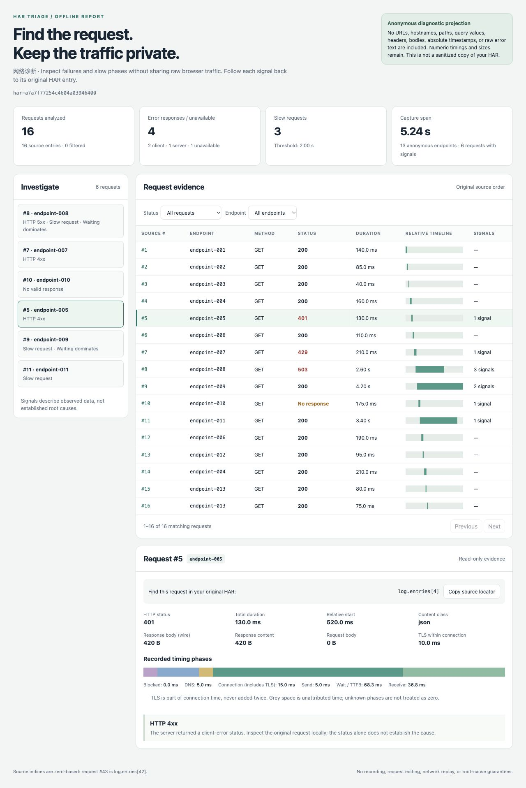

# HAR Triage

Offline network evidence for DeepSeek Harness. Find failed and slow browser requests without handing the agent your URLs, cookies or response bodies.

浏览器网络排障插件：读取本地 HAR，生成可回查原始请求索引的离线诊断报告。默认不把网址、请求头、Cookie、参数值或正文带进报告和 AI 工具结果。



The screenshot uses the bundled synthetic scenario, not real browser traffic.

## What it does

- Reads an existing HAR 1.2 capture; never records traffic, sends requests, or changes the capture.
- Groups requests into endpoint aliases, highlights HTTP 4xx/5xx, unavailable responses, slow requests and long waiting phases.
- Produces a self-contained HTML report: signals → request row → measured timing phases. Filters, pagination and source locators work offline.
- Returns at most 20 evidence entries to the agent, with a count of omitted evidence. The full numeric projection stays in the local JSON/HTML files.

Request #43 corresponds to `log.entries[42]` in your original HAR. Endpoint aliases deliberately do not reveal names. Keep the original capture private and use its index to look up the actual request locally.

## Install in Harness

Node 22.19+ is required. Install the prebuilt bundle into your chosen profile:

```sh
dsh plugin --profile YOUR_PROFILE add https://github.com/po-et/dsh-har-triage/releases/download/v0.1.0/dsh-har-triage-0.1.0.tgz
dsh --profile YOUR_PROFILE --dump-config
```

The configuration should contain the `har-triage` row. Start that profile, put your HAR inside its session workspace, and ask:

> Inspect capture.har with har_triage. Save reports in a new har-review directory. Explain the measured evidence and cite the original HAR entry indexes. Do not guess root causes.

Tool arguments:

```json
{"input":"capture.har","outputDir":"har-review","slowMs":2000}
```

The tool uses Harness filesystem and sandbox services. It requires write permission to create the reports and refuses input/output paths outside the session workspace. Existing report files are never overwritten. Uninstall with `dsh plugin --profile YOUR_PROFILE remove dsh-har-triage`.

## Try without Harness

The CLI and analysis/report modules use Node built-ins only. From a source checkout:

```sh
node src/cli.js capture.har --out new-report-directory --slow-ms 2000
```

Open `new-report-directory/report.html`. The output directory must not exist. The original capture is unchanged.

For a reproducible synthetic example:

```sh
npm run demo
```

This creates a new directory under `artifacts/` with a deliberately synthetic capture and its report. It is not evidence of real browser traffic or real users.

## Evidence, not root-cause claims

`503` means the capture records a server-error response. `status: 0` means it did not record a valid HTTP response. Neither identifies a failing service, proves CORS, or proves an expired token. A high wait/TTFB share is an observation, not proof that the backend or database is slow.

Start offsets include submillisecond differences and are expressed in relative milliseconds. Absolute source timestamps are never included in the report.

Unknown phase timings and byte sizes remain `-1`, displayed as “Unknown.” TLS is part of the HAR connection timing and is not added a second time. Contradictory phase durations are flagged; the report hides misleading proportions.

Ollama's [`application/x-ndjson` streaming responses](https://docs.ollama.com/api/streaming) are classified as JSON. This is a MIME-based content category, not validation of the response body; model output remains excluded from reports.

## What is retained and removed

Retained: source entry index, sequential endpoint alias, controlled method/status/content classes, relative offsets, numeric durations/sizes, and fixed diagnostic codes. Aliases group the same method/origin/path within one capture; query strings and fragments do not affect grouping.

HTTP method identity is case-sensitive: `GET` and `get` receive separate aliases. Only the allowlisted uppercase methods receive named display values; all other method tokens appear as `OTHER`. Private method tokens are used only for grouping and are not included in reports, tool evidence or report ID hashes.

Removed: complete URLs including origins and paths, query values, headers, cookies, request/response bodies, page titles, initiator data, IP addresses, absolute timestamps, extension fields, raw error text, and the original file digest. The report ID hashes only the retained projection. Arbitrary source strings are not copied to reports or tool evidence.

This is a minimal diagnostic projection, **not** a scrubbed HAR, an anonymization guarantee, or a replacement for reviewing an artifact before sharing it. Status patterns, sizes, timing, request counts and grouping can still identify an application. See [SECURITY.md](SECURITY.md).

## Limits

- HAR JSON only: version `1.2`, UTF-8, at most 16 MiB and 10,000 entries. Invalid supported entries fail with fixed errors rather than silently truncating the evidence.
- HTTP and HTTPS requests are analyzed. Other protocols are excluded and counted. Missing timing/size values are retained as unknown; a valid request URL, start timestamp, duration, status and response content object are required.
- Synchronous bounded analysis: cancellation is checked before parsing and between entries, not an interruptible worker. The slow threshold defaults to 2,000 ms and is configurable per call.
- Reports are created exclusively. If HTML creation fails after JSON creation, the JSON is retained and the tool reports the partial result; retry using a fresh destination.
- No upload, traffic replay, header inspection, body analysis, automatic source lookup, or edits to the original HAR.

## Development and validation

```sh
npm ci --ignore-scripts
npm test
npm run smoke:host
npm pack --dry-run
```

48 tests passed on Node 24 and 26. They cover actual CLI subprocesses, controlled output and failure text, input limits, phases, original-file preservation, and real Cordis tool dispatch/filesystem/sandbox/Loader integration. `smoke:host` is a real service composition, not a CLI profile boot or a live-LLM test.

The packed bundle was separately installed through the actual CLI into fresh temporary Profiles on Harness `0.2.0-rc.2` and `0.2.1-alpha.2`, then booted with `runProfile` and exercised through `har_triage`. Source bytes were unchanged; output omitted the synthetic canary; overwrite and workspace-escape attempts were refused. HMR was disabled only in those temporary Profiles. The alpha host emitted three unrelated Typert activation warnings; rc.2 did not. No LLM or real credentials were used.

Browser checks covered status filtering, signal-to-request navigation, correct source locators, no console errors, and a 390-pixel layout without page-level overflow. The demo and regression captures are synthetic; real-user usefulness is not yet validated.

## Related tools

[net-debug](https://github.com/JohnXu22786/net-debug) is an existing Harness HTTP client with history, replay and HAR export. [harlite](https://github.com/brucehart/harlite) already offers extensive HAR analysis, SQL, waterfall and HTML reporting. This plugin does not replace those tools: its narrower purpose is a Harness-native, no-external-binary, allowlisted evidence path for agent-assisted debugging.

MIT licensed.
